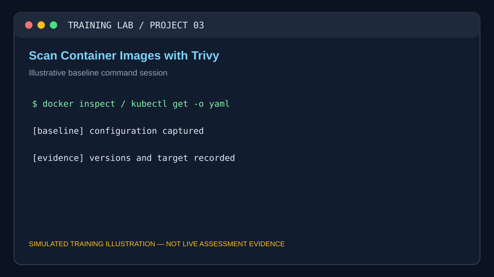
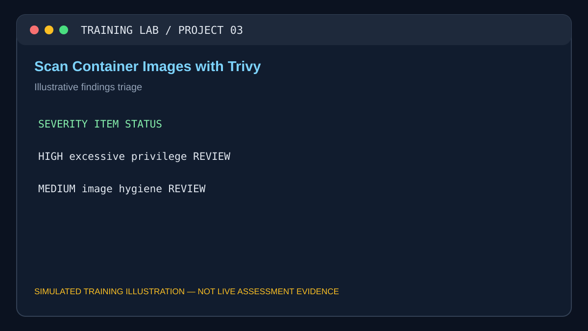
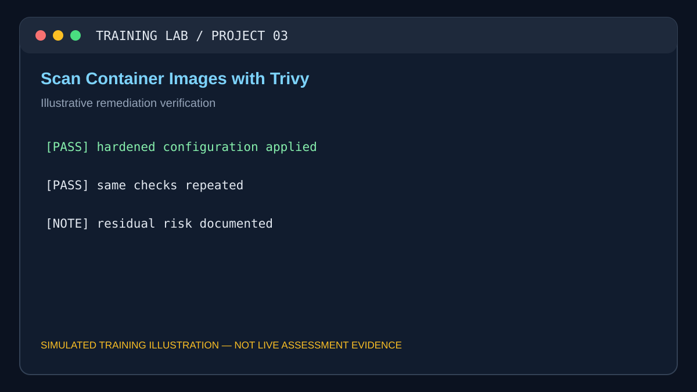

# Project 03: Scan Container Images with Trivy

**Level:** Beginner  
**Domain:** Container and Kubernetes Security  
**Primary tools:** Trivy  
**Status:** Lab walkthrough

## 1. Objectives
Establish an image-scanning workflow, interpret vulnerability severity, and record a remediation decision for each relevant finding.
- Establish a reproducible baseline and capture evidence before and after remediation.
- Explain the security impact in terms of attack surface, privilege, integrity, and operational risk.
- Produce a concise finding with a practical remediation and validation result.

## 2. Scope and authorization
Work only with local containers, disposable virtual machines, and clusters that you own or have written permission to assess. Do not scan public registries or third-party infrastructure without authorization. Use non-production data and credentials. Avoid destructive actions; take a snapshot before changing host or cluster configuration.

## 3. Prerequisites
- Linux workstation or VM with Docker Engine; add a local Kubernetes cluster only where relevant.
- A non-production sample application or image and an account with least-privilege lab access.
- Trivy installed and version recorded.
- A project directory for commands, configuration, scan output, and screenshots.

## 4. Lab setup
1. Create a dedicated working directory: `mkdir -p ~/container-security/project-03/{evidence,output}`.
2. Record tool versions and the target image/workload identifier.
3. Pull or build a disposable sample target; record its immutable image digest where available.
4. Save the initial configuration and baseline scan output before changing anything.

## 5. Guided workflow
1. **Baseline:** inspect the current image, runtime settings, or Kubernetes resource relevant to this project.
2. **Assessment:** run the commands below and preserve complete output in the evidence directory.
3. **Triage:** separate confirmed issues from informational observations; note affected component, version, severity, and exploit preconditions.
4. **Remediation:** apply the hardening guidance in Section 8 to a copy or lab deployment.
5. **Retest:** repeat the same checks against the exact changed artifact and compare results.
6. **Document:** record what changed, residual risk, and any compatibility trade-offs.

## 6. Commands and configuration

Run in the authorized lab:

```bash
trivy image --format table nginx:stable
trivy image --severity HIGH,CRITICAL --ignore-unfixed nginx:stable
trivy image --format json -o trivy-results.json nginx:stable
```

Capture command output without exposing credentials. For Kubernetes projects, use a dedicated namespace and explicit context, for example `kubectl config current-context` and `kubectl get pods -n <lab-namespace>`. Review every command before execution and adapt image tags, paths, and namespace names to the disposable lab.

## 7. Expected observations
- A baseline report identifying configuration choices and any relevant weaknesses.
- Evidence that distinguishes a vulnerable/default state from the hardened state.
- A reproducible record of the image digest, workload name, tool version, timestamp, and command used.
- A short explanation of false positives, unfixable findings, and residual exposure.

## 8. Risk analysis and remediation
Prioritize reachable critical/high findings, update affected packages or base images, document accepted exceptions, and rescan the exact rebuilt digest.
- Prefer supported upstream images and vendor security updates.
- Apply least privilege and minimize exposed interfaces, capabilities, packages, and credentials.
- Treat exceptions as time-bound risk acceptances with an owner and compensating control.
- Do not suppress a finding solely to make a scan pass; record the rationale and evidence.

## 9. Validation criteria
- [ ] Assessment is limited to the authorized lab scope.
- [ ] Baseline configuration and tool versions are recorded.
- [ ] Findings include evidence, severity rationale, and affected asset.
- [ ] Remediation is applied to the source configuration or build pipeline.
- [ ] The same checks are repeated after remediation.
- [ ] Remaining risks and exceptions are documented.

## 10. Security mapping
Use the mappings that fit the actual finding; do not force a mapping where no weakness exists:
- **CIS Docker Benchmark / CIS Kubernetes Benchmark:** configuration and hardening guidance.
- **NIST SP 800-190:** application container security considerations.
- **MITRE ATT&CK Containers:** relevant technique mapping when a demonstrated behavior supports it.
- **CWE:** map a concrete software weakness only when applicable (for example, CWE-250 for execution with unnecessary privileges).

## 11. Evidence and reporting
Store sanitized command output, configuration diffs, scan reports, image digests, and before/after screenshots under `evidence/`. Redact tokens, passwords, private registry credentials, internal hostnames, and personal data. The final finding should contain: title, asset, observation, impact, likelihood, evidence, remediation, validation result, and residual risk.

## 12. Training illustrations

These three illustrations are synthetic examples to explain the workflow. They are not screenshots from a live scan or proof of a real vulnerability.







## 13. Completion checklist
- [ ] Lab setup documented
- [ ] Baseline assessment completed
- [ ] Findings triaged and risk explained
- [ ] Hardening changes applied
- [ ] Retest completed and evidence saved
- [ ] Final report prepared
