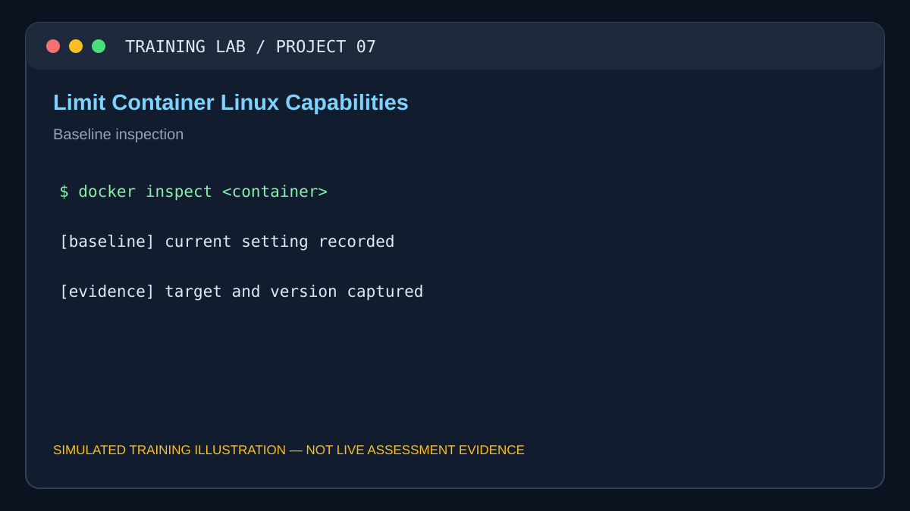
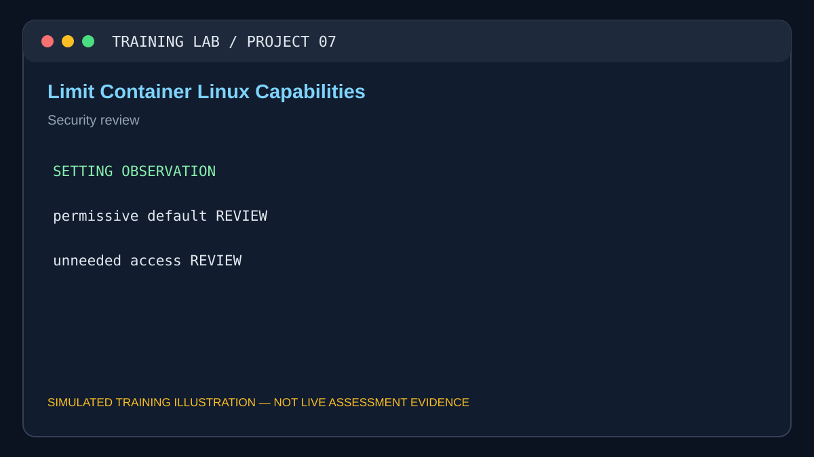
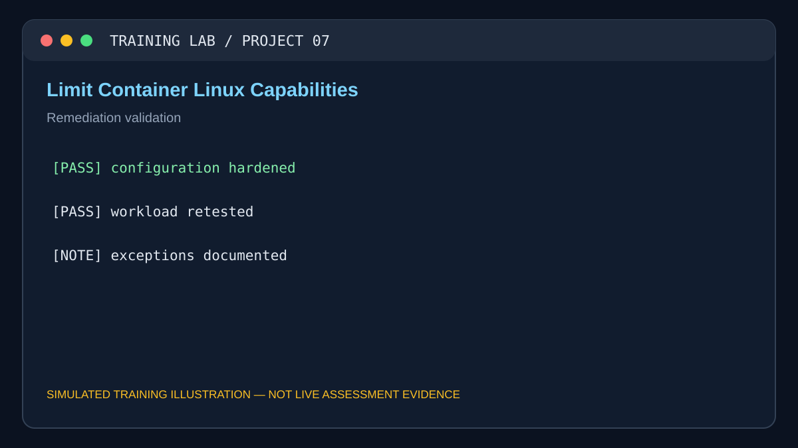

# Project 07: Limit Container Linux Capabilities

**Level:** Beginner  
**Tools:** Docker, Linux capabilities

## 1. Objectives
Reduce the Linux capability set and verify that the workload operates with only the privileges it needs.
- Capture a baseline and compare it with the hardened configuration.
- Explain the security impact and operational trade-offs.
- Produce reproducible evidence and a concise remediation report.

## 2. Scope and authorization
Use only local containers, disposable VMs, and clusters you own or are explicitly authorized to assess. Use synthetic data and credentials. Do not change production hosts or workloads as part of this exercise. Snapshot the lab before host-level changes.

## 3. Prerequisites
- Linux workstation or VM with Docker Engine and Compose plugin as applicable.
- A disposable sample container or application.
- Docker, Linux capabilities installed; record tool versions.
- A working directory for configuration, scan output, and sanitized evidence.

## 4. Lab setup
1. Create a workspace: `mkdir -p ~/container-security/project-07/{evidence,output}`.
2. Record Docker and tool versions.
3. Select a disposable image and record its tag and digest.
4. Save the initial configuration before making changes.

## 5. Guided workflow
1. Inspect the baseline runtime and configuration.
2. Execute the commands in Section 6 and save output.
3. Identify which settings are unnecessarily permissive or expose sensitive data.
4. Apply one controlled change at a time.
5. Restart or recreate the lab workload and verify behavior.
6. Repeat the baseline checks and compare results.

## 6. Commands
```bash
docker run --rm --cap-drop=ALL --cap-add=NET_BIND_SERVICE alpine:3.20 sh -c 'grep Cap /proc/self/status'
docker run --rm --cap-drop=ALL alpine:3.20 sh -c 'grep Cap /proc/self/status'
```
Replace placeholders such as `<lab-container>` with the name of your disposable target. Review commands before running; do not paste secrets into terminals or reports.

## 7. Expected observations
- A clear baseline showing the initial runtime or configuration state.
- Evidence of the changed setting and its effect.
- Any compatibility issue, false positive, or residual exposure documented separately.

## 8. Remediation guidance
Drop all capabilities by default and add back only documented requirements; never use --privileged as a workaround.
- Apply least privilege and keep the host/cluster control plane protected.
- Make changes in source configuration so they persist through rebuilds and redeployments.
- Pin supported image versions and track security updates.
- Document exceptions with an owner, rationale, compensating control, and review date.

## 9. Validation
- [ ] Authorized lab scope confirmed
- [ ] Tool versions and target digest recorded
- [ ] Baseline evidence saved
- [ ] Hardening change applied to source configuration
- [ ] Workload behavior retested
- [ ] Before/after evidence and residual risks documented

## 10. Security mapping
Use the applicable guidance: CIS Docker Benchmark, NIST SP 800-190, and relevant Kubernetes/Docker vendor hardening documentation. Map to CWE only when a concrete software weakness is present; unnecessary privilege may align with CWE-250.

## 11. Reporting
Include asset, image digest, observation, impact, likelihood, evidence, remediation, validation result, and residual risk. Redact passwords, tokens, private registry credentials, and personal data.

## 12. Training illustrations
The images below are synthetic workflow examples, not screenshots from a live assessment.







## 13. Completion checklist
- [ ] Baseline assessment
- [ ] Risk analysis
- [ ] Remediation
- [ ] Retest
- [ ] Evidence and final report
