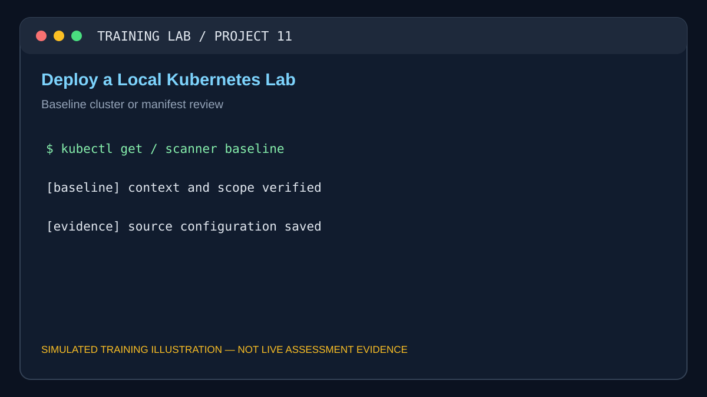
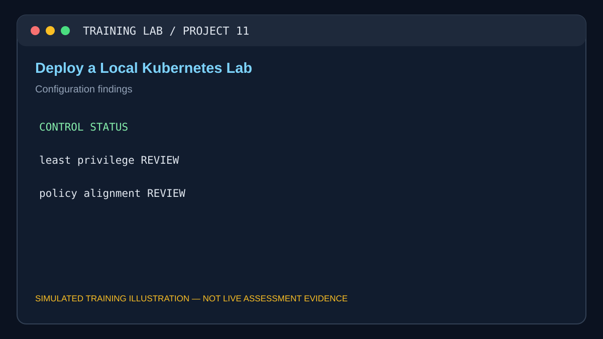
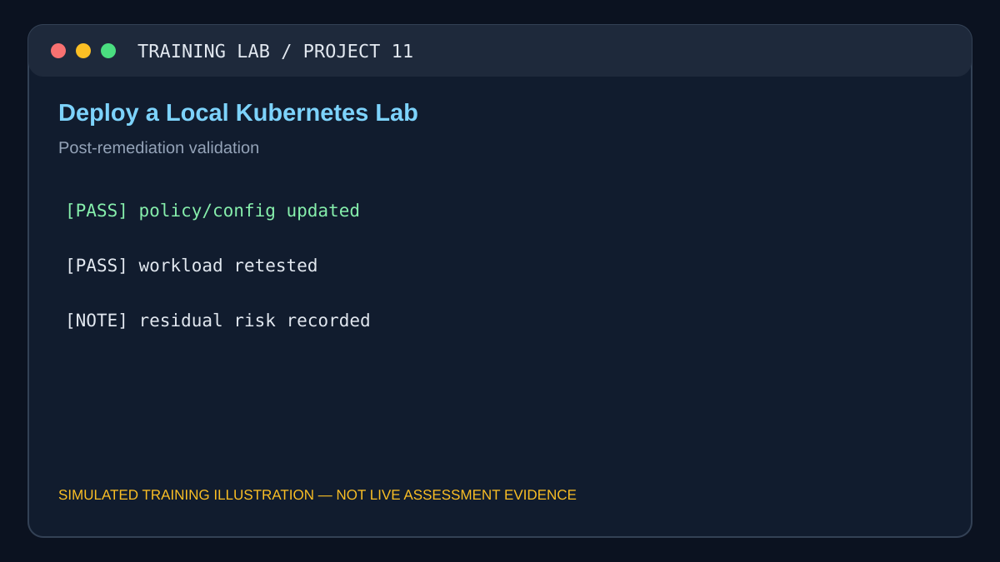

# Project 11: Deploy a Local Kubernetes Lab

**Level:** Beginner  
**Tools:** kind, kubectl, Docker

## 1. Objectives
Create an isolated local cluster and establish a secure baseline for hands-on Kubernetes exercises.
- Establish a repeatable, authorized lab workflow.
- Identify configuration weaknesses and explain their impact.
- Apply a remediation and validate it with the same checks.

## 2. Scope and authorization
Use only local clusters and workloads you own or have explicit permission to assess. Keep exercises isolated from production and public infrastructure. Use synthetic data and credentials. Do not expose Kubernetes API endpoints publicly for this lab.

## 3. Prerequisites
- Linux workstation or VM with Docker and kubectl.
- kind, kubectl, Docker installed and version recorded.
- Local cluster or sample manifests as required.
- Dedicated project folder for configuration, reports, and sanitized evidence.

## 4. Lab setup
1. Create `~/container-security/project-11/{evidence,manifests,output}`.
2. Confirm the active Kubernetes context before running cluster commands.
3. Use a dedicated namespace and a disposable workload.
4. Save original manifests and baseline scan output.

## 5. Guided workflow
1. **Discover:** identify cluster, namespace, workload, and image versions in scope.
2. **Baseline:** inspect relevant manifests and run the initial checks.
3. **Analyze:** validate scanner findings against actual configuration and runtime context.
4. **Remediate:** change source YAML or policy configuration, not just the live object.
5. **Retest:** redeploy and repeat the same checks.
6. **Report:** capture the diff, evidence, impact, and remaining risk.

## 6. Commands
```bash
kind create cluster --name security-lab
kubectl config current-context
kubectl get nodes -o wide
kubectl get pods -A
```
Use your own lab context and resource names. For cluster-changing commands, confirm `kubectl config current-context` and namespace first.

## 7. Expected observations
- Baseline cluster/workload configuration and tool versions.
- Findings supported by manifest excerpts or command output.
- A clear before/after comparison and documented exceptions.
- A repeatable cleanup procedure for the lab.

## 8. Remediation
Keep the cluster local, use a dedicated context and namespace, restrict API access, and delete the lab cluster when finished.
- Prefer declarative configuration stored in version control.
- Apply least privilege to human users, service accounts, and workloads.
- Avoid broad cluster-admin permissions and unnecessary host access.
- Revalidate application behavior after hardening changes.

## 9. Validation checklist
- [ ] Authorized lab and active context confirmed
- [ ] Baseline evidence saved
- [ ] Findings manually reviewed
- [ ] Remediation committed to source configuration
- [ ] Workload redeployed and retested
- [ ] Residual risks and exceptions documented

## 10. Security references
Use the CIS Kubernetes Benchmark, Kubernetes official security guidance, NIST SP 800-190, and the relevant tool documentation. Map to CWE only where a specific software weakness is established; do not treat every configuration deviation as a CWE.

## 11. Evidence and reporting
Record cluster/context, namespace, workload name, image digest, tool versions, command, timestamp, sanitized output, configuration diff, severity rationale, remediation owner, and retest result. Redact secrets, tokens, kubeconfigs, and personal data.

## 12. Training illustrations
These synthetic illustrations explain the workflow; they are not screenshots or evidence from a live cluster.







## 13. Completion
- [ ] Baseline assessment complete
- [ ] Findings triaged
- [ ] Hardening applied
- [ ] Retest passed or residual risk accepted
- [ ] Evidence package and report complete
