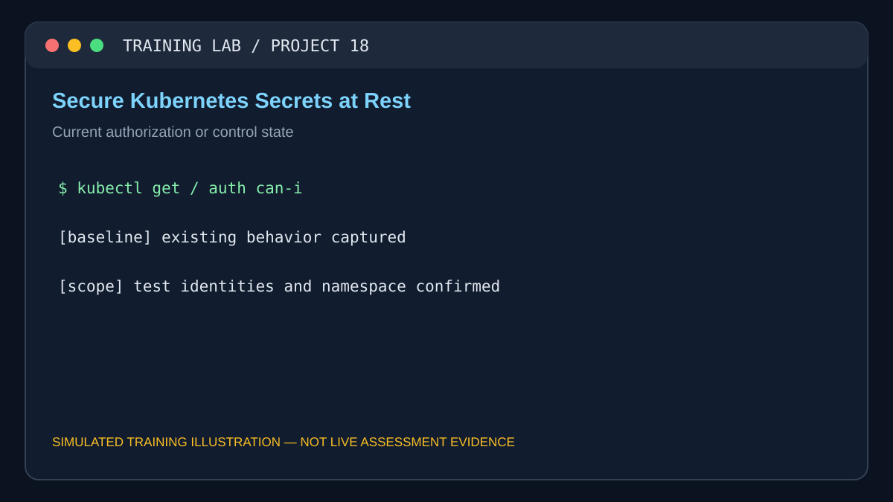
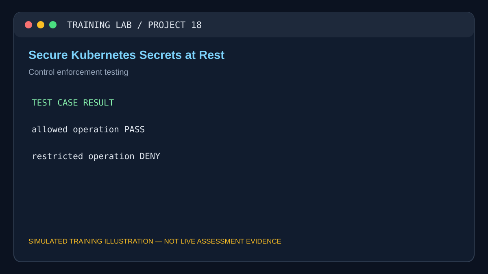
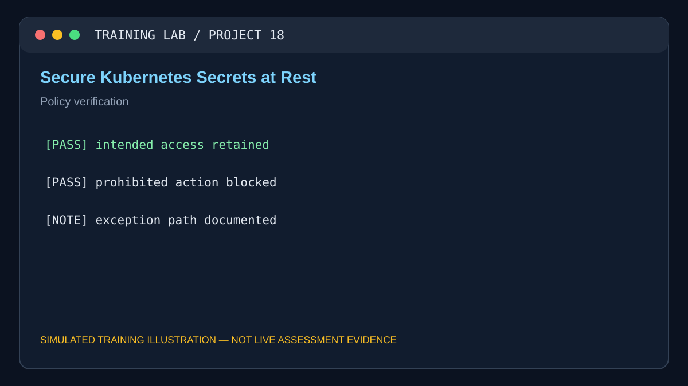

# Project 18: Secure Kubernetes Secrets at Rest

**Level:** Intermediate  
**Tools:** Kubernetes, KMS/provider encryption

## 1. Objectives
Review secret handling, enable encryption at rest where supported, and verify access boundaries.
- Model the current state and intended security boundary.
- Validate both positive and negative test cases.
- Implement a maintainable control and document operational impact.

## 2. Scope and authorization
Use only a disposable cluster and test identities under your control. Do not probe external clusters or alter shared production policies. Keep a break-glass administrator path available for lab recovery and avoid storing production credentials in the exercise.

## 3. Prerequisites
- Working Kubernetes lab with a dedicated namespace and test workloads.
- Kubernetes, KMS/provider encryption installed; record versions and cluster context.
- A test service account/user and a minimal sample application.
- Git-controlled manifests and an evidence directory.

## 4. Lab setup
1. Confirm the active context: `kubectl config current-context`.
2. Create or select namespace `team-a`; label it as a lab.
3. Deploy two simple test workloads and verify their labels/selectors.
4. Save the baseline YAML and current policy state.

## 5. Guided workflow
1. Inspect the existing control and identify its default behavior.
2. Define the intended boundary in plain language before writing policy.
3. Implement the control in version-controlled YAML.
4. Test a permitted action/flow and a prohibited action/flow.
5. Review logs and events to confirm enforcement, not merely configuration presence.
6. Document exceptions, operational impact, and rollback procedure.

## 6. Commands
```bash
kubectl get secrets -n team-a
kubectl auth can-i get secrets -n team-a --as=system:serviceaccount:team-a:reader
kubectl get apiservers.config.openshift.io cluster -o yaml 2>/dev/null || true
```
Replace example namespaces, identities, registries, and digests with values from your disposable lab. Confirm the active context before applying changes.

## 7. Expected observations
- A baseline showing the previous access or policy behavior.
- A positive test demonstrating intended operation.
- A negative test demonstrating that the restricted operation is denied.
- Evidence of enforcement and any compatibility issue.

## 8. Remediation and hardening
Enable provider-supported encryption at rest, restrict RBAC, avoid secrets in Git and command arguments, rotate exposed credentials, and use an external secret manager where appropriate.
- Keep policies declarative and peer-reviewed.
- Apply least privilege and avoid wildcard permissions or broad exceptions.
- Monitor policy changes and periodically revalidate assumptions.
- Maintain a documented rollback path that does not weaken production security.

## 9. Validation
- [ ] Lab scope and context confirmed
- [ ] Baseline configuration captured
- [ ] Positive test passes
- [ ] Negative test is denied as expected
- [ ] Logs/events support the result
- [ ] Exception and rollback procedures documented

## 10. Security mapping
Relevant references include CIS Kubernetes Benchmark, Kubernetes Security Checklist/official documentation, NIST SP 800-190, and MITRE ATT&CK Containers where a technique is demonstrated. Map to CWE only for a concrete software weakness, not simply a policy preference.

## 11. Evidence and reporting
Capture sanitized manifests, policy diffs, identity/context, command output, events, timestamps, and before/after test results. Report affected namespace/workload, impact, likelihood, remediation owner, validation result, and residual risk. Never publish kubeconfigs, tokens, secret values, or private registry credentials.

## 12. Training illustrations
Synthetic workflow illustrations only; they do not represent a live cluster or real findings.







## 13. Completion
- [ ] Intended boundary documented
- [ ] Control implemented as code
- [ ] Allowed and denied cases tested
- [ ] Evidence reviewed and sanitized
- [ ] Residual risks and exceptions recorded
