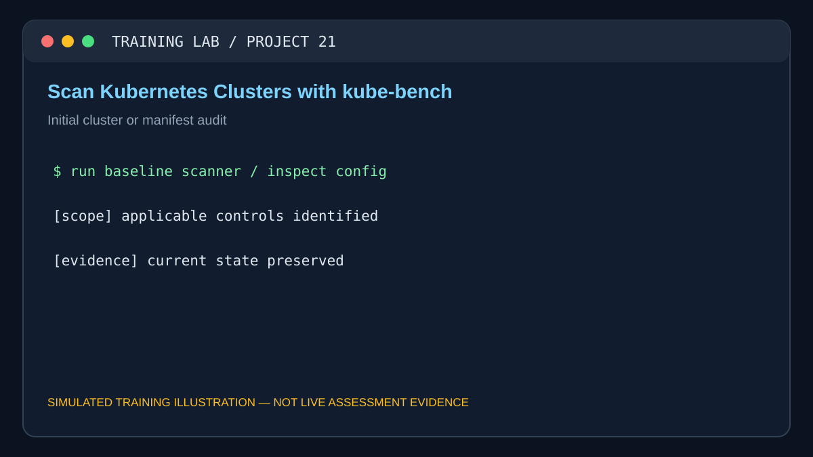
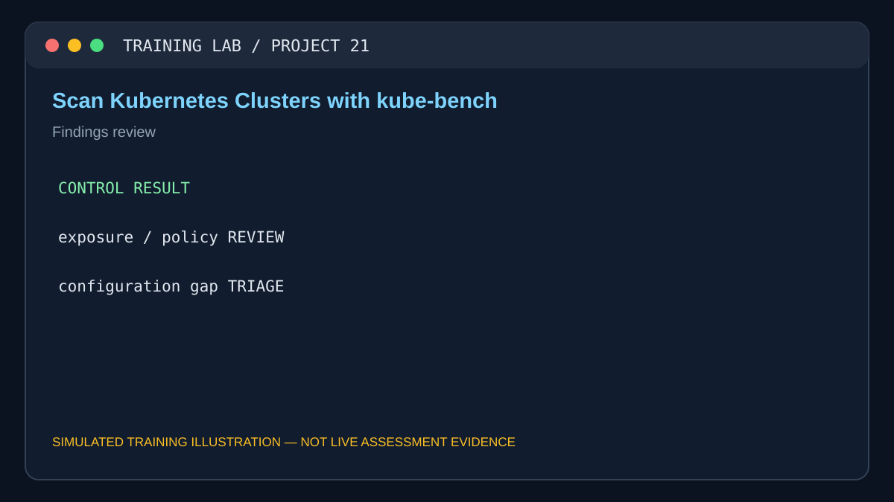
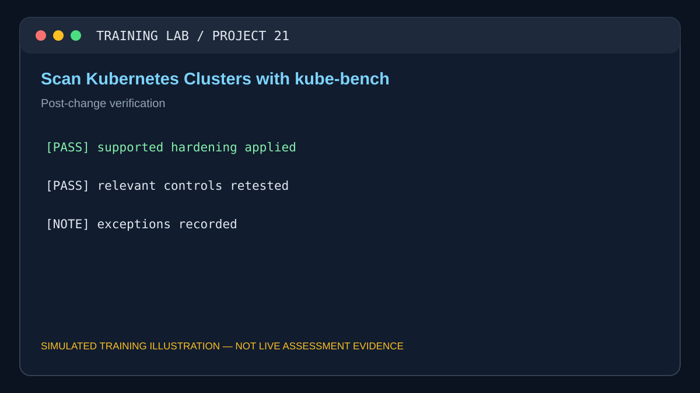

# Project 21: Scan Kubernetes Clusters with kube-bench

**Level:** Intermediate  
**Tools:** kube-bench, Kubernetes

## 1. Objectives
Assess cluster configuration against applicable CIS Kubernetes Benchmark controls and triage deviations.
- Establish a baseline against recognized security guidance.
- Verify findings in the target configuration rather than relying on scanner status alone.
- Prioritize remediation by exposure, impact, and feasibility.

## 2. Scope and authorization
Assess only the lab cluster, manifests, and services you control. Do not probe public API endpoints or third-party registries. Keep administrative access available for recovery and test changes in a disposable environment first.

## 3. Prerequisites
- Disposable Kubernetes cluster and dedicated namespace.
- kube-bench, Kubernetes installed; record versions and cluster distribution.
- Sample manifests or ingress/chart/policy resources.
- Git repository for reviewed configuration and an evidence folder.

## 4. Lab setup
1. Confirm context and cluster version.
2. Create a dedicated namespace and deploy a minimal sample workload.
3. Save existing configuration and relevant service endpoints.
4. Record tool versions and benchmark/policy version.

## 5. Assessment workflow
1. Identify applicable controls and exclusions for the cluster distribution.
2. Run the baseline scan or configuration inspection.
3. Validate high-risk findings manually against the actual runtime and configuration.
4. Prioritize internet exposure, privilege, authentication, secrets, and control-plane risks.
5. Implement changes through source configuration or supported cluster settings.
6. Repeat checks and record any remaining exceptions.

## 6. Commands
```bash
kube-bench run --targets master,node,policies
kubectl get nodes -o wide
kubectl get pods -A
```
Replace placeholders with resources in your own lab. Do not copy private endpoints, tokens, certificates, or secret values into evidence.

## 7. Expected observations
- Baseline result with applicable benchmark/policy version.
- Findings grouped by severity and affected component.
- Manual validation notes that distinguish real exposure from environment-specific false positives.
- A before/after configuration diff and retest result.

## 8. Remediation guidance
Use the benchmark version appropriate to the Kubernetes distribution, validate each failed control manually, and remediate through supported configuration management.
- Apply changes using supported distribution-specific procedures.
- Keep least privilege, strong identity, and centralized audit logging as core requirements.
- Document compensating controls and review dates for accepted exceptions.

## 9. Validation
- [ ] Scope and cluster context confirmed
- [ ] Tool and control versions recorded
- [ ] Findings manually validated
- [ ] Remediation applied through source/configuration management
- [ ] Relevant tests repeated
- [ ] Exceptions and residual risks approved

## 10. Security mapping
Use CIS Kubernetes Benchmark, NIST SP 800-190, Kubernetes hardening guidance, and relevant vendor documentation. MITRE ATT&CK Containers may help describe demonstrated behaviors. Use CWE only when a concrete software weakness is established.

## 11. Evidence and reporting
Capture sanitized scan output, control identifiers, affected resources, configuration diffs, timestamps, tool versions, and retest output. Report business impact, likelihood, remediation owner, due date, validation status, and residual risk. Never attach kubeconfigs, private keys, or secret manifests containing live values.

## 12. Training illustrations
Synthetic examples for learning only; not live screenshots or proof of a real finding.







## 13. Completion
- [ ] Baseline recorded
- [ ] Findings reviewed and prioritized
- [ ] Remediation implemented
- [ ] Retest evidence captured
- [ ] Final assessment report completed
