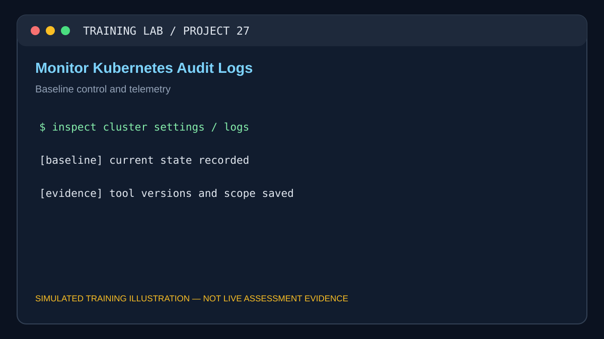
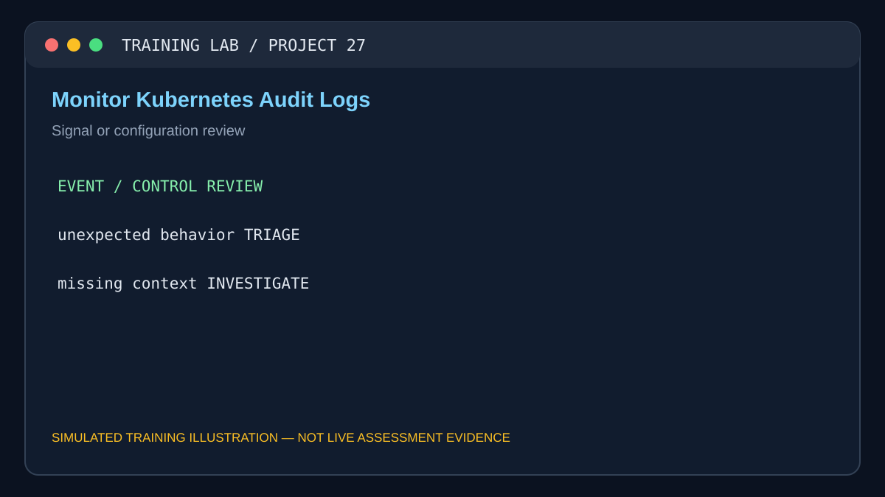
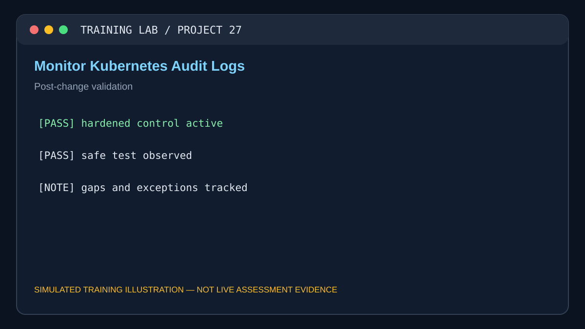

# Project 27: Monitor Kubernetes Audit Logs

**Level:** Intermediate  
**Tools:** Kubernetes audit policy, log backend

## 1. Objectives
Define an audit policy that records security-relevant API activity without unnecessarily logging sensitive request bodies.
- Build a repeatable monitoring or hardening workflow.
- Validate behavior with safe test data and a disposable workload.
- Preserve enough context to investigate and remediate issues.

## 2. Scope and authorization
Perform all tests in a cluster and account you control. Use a disposable namespace, synthetic identities, and non-sensitive data. Do not generate disruptive events on production nodes or alter managed control-plane components outside approved procedures.

## 3. Prerequisites
- Kubernetes lab with cluster-admin access for setup and a separate least-privilege test identity.
- Kubernetes audit policy, log backend installed; record versions.
- A sample workload and dedicated namespace.
- Secure evidence storage with access limited to the project team.

## 4. Lab setup
1. Confirm the Kubernetes context and cluster distribution.
2. Create namespace `team-a` and deploy a minimal test workload.
3. Record current policies, storage, identity, or logging configuration.
4. Snapshot relevant settings before modification.

## 5. Guided workflow
1. Identify the security objective and control boundary.
2. Inspect the baseline configuration and available telemetry.
3. Configure the selected control using supported mechanisms.
4. Generate a benign test event or query in the disposable lab.
5. Confirm expected enforcement/telemetry and investigate missing context.
6. Tune, remediate, and repeat the test.

## 6. Commands
```bash
kubectl get --raw /metrics | head
kubectl get events -A --sort-by=.metadata.creationTimestamp
```
Replace placeholders with your lab resource names. Avoid printing secret values or exposing node credentials.

## 7. Expected observations
- Baseline configuration and a record of tool versions.
- Relevant logs, events, access decisions, or storage metadata.
- A controlled test that demonstrates the expected result.
- Documented false positives, blind spots, and operational constraints.

## 8. Remediation and hardening
Enable audit logging at the control plane using distribution-supported settings, capture metadata for sensitive resources, protect logs, and establish retention/alerting.
- Prefer supported, version-controlled configuration.
- Restrict access to sensitive telemetry and infrastructure settings.
- Define ownership, alert thresholds, retention, and recovery procedures.
- Reassess after cluster upgrades and changes to workload architecture.

## 9. Validation
- [ ] Scope and cluster context confirmed
- [ ] Baseline evidence preserved
- [ ] Control configured using supported settings
- [ ] Safe test event/action performed
- [ ] Expected enforcement or telemetry verified
- [ ] Gaps and exceptions documented

## 10. Security mapping
Use CIS Kubernetes Benchmark, NIST SP 800-190, Kubernetes official security guidance, and applicable cloud-provider controls. MITRE ATT&CK Containers can classify demonstrated runtime behaviors. Map to CWE only for a confirmed software weakness.

## 11. Evidence and reporting
Capture sanitized configuration, command output, event/log excerpts, timestamps, workload identity, and before/after comparison. Include business impact, remediation owner, validation status, and residual risk. Redact tokens, certificates, cloud credentials, and personal data.

## 12. Training illustrations
These are synthetic workflow illustrations, not actual runtime alerts or live cluster screenshots.







## 13. Completion
- [ ] Baseline documented
- [ ] Control deployed
- [ ] Safe test completed
- [ ] Telemetry/enforcement verified
- [ ] Remediation and report completed
