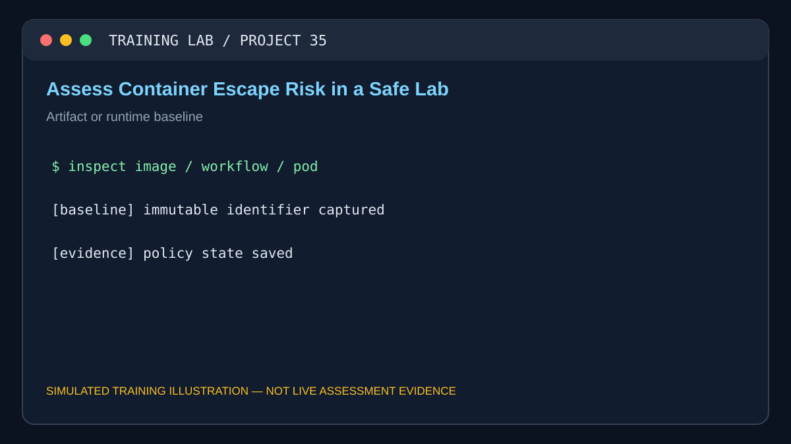
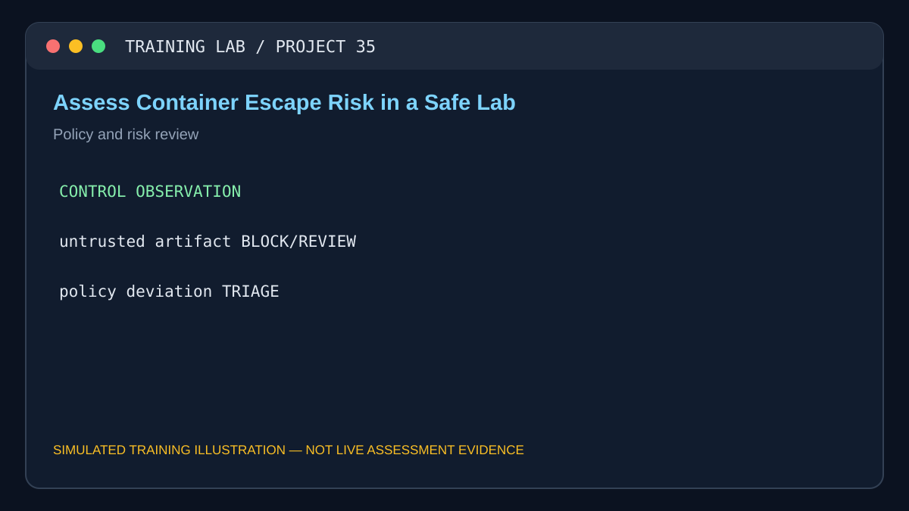
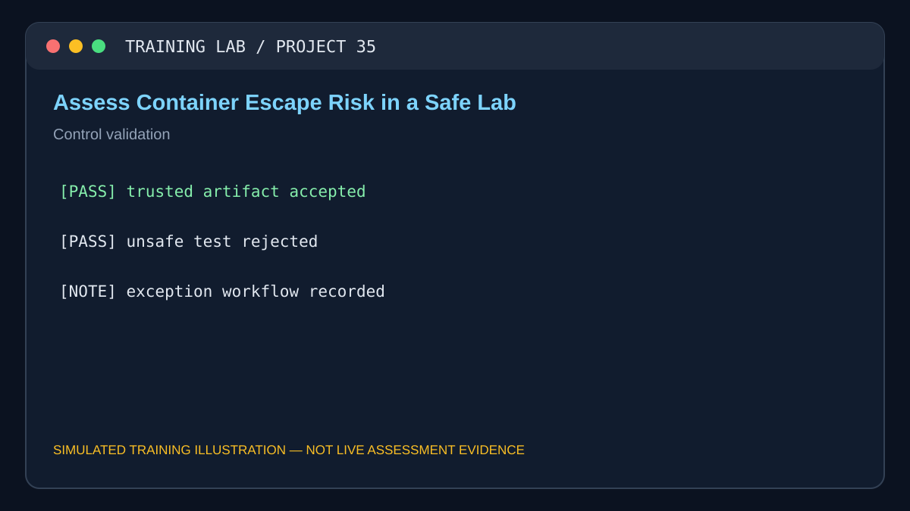

# Project 35: Assess Container Escape Risk in a Safe Lab

**Level:** Intermediate  
**Tools:** Docker, Kubernetes, Falco, Linux

## 1. Objectives
Review risky container configurations and validate detection using non-destructive checks without attempting host compromise.
- Integrate the control into a repeatable build, release, or operations workflow.
- Verify the artifact/configuration identity and preserve traceable evidence.
- Define an exception process that does not silently bypass security checks.

## 2. Scope and authorization
Use only images, registries, repositories, and clusters that you own or are authorized to administer. Use a disposable image and test pipeline. Do not sign production artifacts with lab keys or alter a production deployment gate during this exercise.

## 3. Prerequisites
- A sample container image and isolated registry/repository.
- Docker, Kubernetes, Falco, Linux installed and version recorded.
- Test CI workflow or GitOps lab environment as applicable.
- Dedicated test keys/identities and sanitized evidence storage.

## 4. Lab setup
1. Create a test project and build or pull a non-sensitive sample image.
2. Record its immutable digest.
3. Set up a test pipeline/registry/cluster context.
4. Save current policy and pipeline configuration.

## 5. Guided workflow
1. Identify the artifact lifecycle and trust boundaries.
2. Capture a baseline report for the image or deployment.
3. Configure the selected control in the build/release process.
4. Test a compliant case and a deliberately noncompliant case using disposable artifacts.
5. Confirm the gate, signature, drift alert, or runtime control behaves as expected.
6. Record the result, exceptions, and rollback procedure.

## 6. Commands
```bash
docker inspect <lab-container> --format '{{.HostConfig.Privileged}} {{.HostConfig.PidMode}} {{.HostConfig.NetworkMode}}'
docker inspect <lab-container> --format '{{json .HostConfig.CapAdd}}'
 kubectl get pods -A -o yaml | grep -E 'privileged:|hostPID:|hostNetwork:'
```
Substitute your lab registry, image digest, repository, and resource names. Never paste private keys or access tokens into shell history or commit them to Git.

## 7. Expected observations
- Artifact identity and provenance information.
- Machine-readable scan, signature, policy, or drift output.
- Positive and negative test results.
- A clear record of why an artifact was allowed, blocked, or excepted.

## 8. Remediation and hardening
Remove privileged mode, host namespaces, broad device mounts, and excess capabilities; use seccomp/AppArmor/SELinux and monitor runtime behavior. Do not attempt host escape.
- Use immutable digests rather than mutable tags for release decisions.
- Protect credentials and signing identities with least privilege and rotation.
- Keep CI runners isolated and restrict write permissions.
- Track exceptions with an accountable owner and expiration date.

## 9. Validation
- [ ] Disposable lab scope confirmed
- [ ] Artifact digest and tool versions recorded
- [ ] Control integrated into source workflow
- [ ] Positive test passes
- [ ] Negative test is blocked or alerted
- [ ] Evidence and exception path reviewed

## 10. Security mapping
Relevant references include NIST SP 800-190, SLSA, in-toto, OCI image specifications, CIS Kubernetes Benchmark, and MITRE ATT&CK Containers where applicable. Use CWE only for a demonstrated software weakness.

## 11. Evidence and reporting
Capture sanitized pipeline logs, image digests, SBOM/signature metadata, policy files, alert timestamps, and before/after results. Report asset, impact, exploit preconditions, remediation owner, validation, and residual risk. Redact secrets, private signing keys, and registry credentials.

## 12. Training illustrations
These are synthetic training visuals, not output from a real registry or CI system.







## 13. Completion
- [ ] Baseline captured
- [ ] Control integrated
- [ ] Compliant and noncompliant cases tested
- [ ] Findings remediated or excepted
- [ ] Evidence and final report completed
