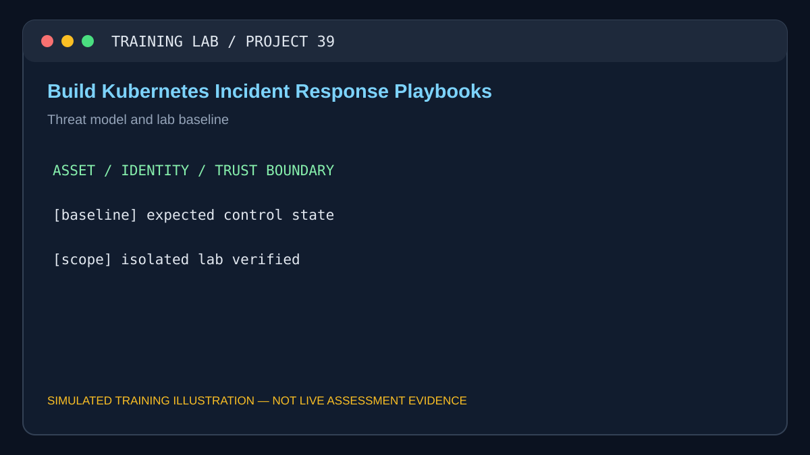
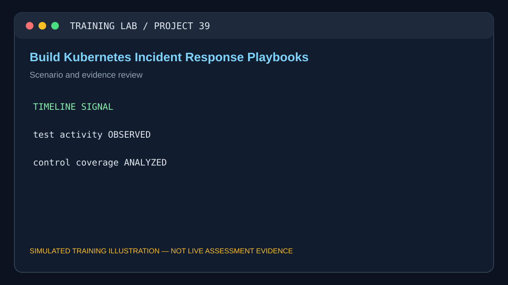
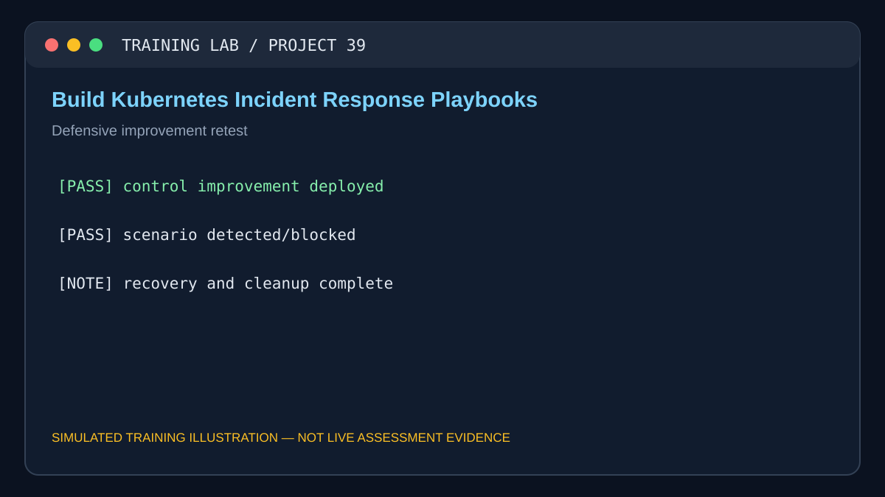

# Project 39: Build Kubernetes Incident Response Playbooks

**Level:** Advanced  
**Tools:** Kubernetes, Falco, audit logs, runbooks

## 1. Objectives
Create a response workflow for suspected compromised workloads, including triage, containment, evidence, eradication, and recovery.
- Define the security assumptions, trust boundaries, and measurable success criteria.
- Execute a controlled scenario in an isolated lab and collect relevant telemetry.
- Translate observations into architecture or detection improvements.

## 2. Scope, authorization, and safety
This is a defensive lab exercise. Use only a cluster and identities you administer. All simulated activity must remain inside the disposable namespace and must not target external systems, production workloads, or shared control planes. Establish a recovery plan before testing. Do not attempt real credential theft, host escape, destructive payloads, or denial of service.

## 3. Prerequisites
- Isolated Kubernetes cluster with a dedicated test namespace.
- Kubernetes, Falco, audit logs, runbooks installed and configured.
- Test workloads, synthetic identities, and non-sensitive data.
- Access to audit logs/events and a secure evidence repository.
- Documented rollback and recovery procedure.

## 4. Lab architecture
1. Record cluster version, nodes, namespaces, CNI, and runtime.
2. Diagram actors, workloads, identities, network paths, and control-plane dependencies.
3. Define in-scope assets and explicitly excluded systems.
4. Record baseline policies, service accounts, and relevant detections.

## 5. Exercise plan
1. Write a hypothesis and expected defensive signal before running tests.
2. Use a benign, bounded scenario in the lab (for example, an intentionally over-permissioned test service account or a synthetic runtime event).
3. Collect relevant audit events, runtime alerts, pod metadata, and configuration.
4. Correlate activity by timestamp, namespace, pod, image digest, node, and identity.
5. Evaluate whether the control detected, blocked, or missed the scenario.
6. Improve the policy, detection, or response playbook and rerun the same scenario.

## 6. Commands
```bash
kubectl get pods -A -o wide
kubectl get events -A --sort-by=.metadata.creationTimestamp
kubectl describe pod <lab-pod> -n team-a
```
Replace placeholders with lab resource names. Review every command and confirm the active context. Never use production credentials or expose secrets in logs.

## 7. Analysis and expected observations
- A documented threat hypothesis and expected observable behavior.
- Timeline of relevant API, workload, or network events.
- Correlation between identity, workload, image, node, and action.
- Detection/containment gaps with evidence and confidence level.
- A retest showing whether the defensive change improved coverage.

## 8. Defensive improvements
Prepare scoped containment actions, preserve logs and metadata before deleting resources, rotate affected credentials, rebuild from trusted images, and verify recovery.
- Apply defense in depth across identity, admission, network, runtime, and audit layers.
- Prefer short-lived credentials, immutable artifacts, and declarative policy.
- Preserve forensic context before deleting or recreating a workload.
- Assign owners and measurable validation criteria to each improvement.

## 9. Validation criteria
- [ ] Scope and safety boundaries documented
- [ ] Threat hypothesis and expected signals defined
- [ ] Scenario executed only in disposable lab
- [ ] Telemetry correlated and preserved
- [ ] Detection/control gap identified
- [ ] Defensive improvement retested successfully
- [ ] Cleanup and recovery completed

## 10. Security framework mapping
Map demonstrated behaviors to MITRE ATT&CK Containers where appropriate. Use CIS Kubernetes Benchmark, NIST SP 800-190, NIST SP 800-61 incident response guidance, and Kubernetes security documentation. Threat model with STRIDE or an equivalent method. Avoid assigning a CWE unless a specific software weakness is verified.

## 11. Evidence and reporting
Maintain a timestamped timeline, sanitized audit/runtime events, resource YAML, policy diffs, tool versions, image digests, and test results. Include executive summary, scope, assumptions, finding, impact, likelihood, evidence, remediation, retest, and residual risk. Protect evidence integrity and redact secrets and personal data.

## 12. Training illustrations
Synthetic training illustrations only; they are not screenshots from a live cluster or proof of compromise.







## 13. Completion
- [ ] Threat model and lab diagram complete
- [ ] Safe scenario executed
- [ ] Evidence timeline prepared
- [ ] Defensive control improved
- [ ] Retest and cleanup completed
- [ ] Final report delivered
