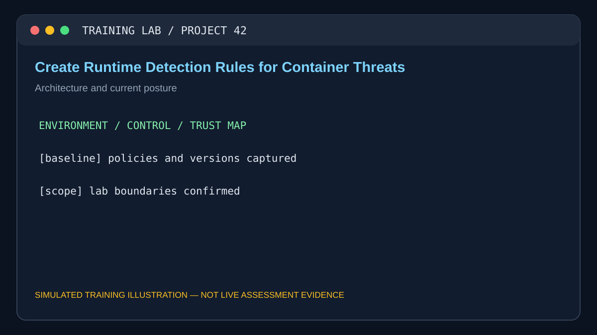
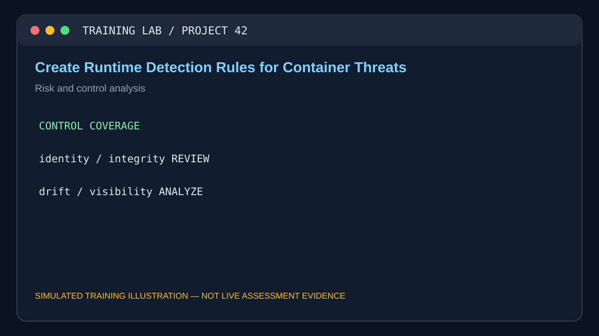
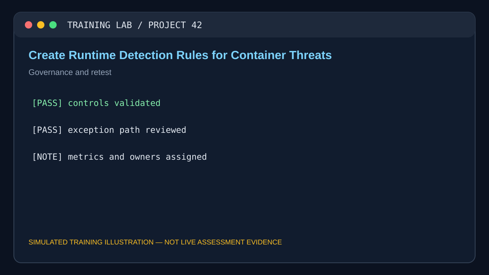

# Project 42: Create Runtime Detection Rules for Container Threats

**Level:** Advanced  
**Tools:** Falco, Kubernetes audit logs

## 1. Objectives
Write and validate runtime detection logic for suspicious but safely simulated container behaviors.
- Define an enterprise-ready control objective and measurable success criteria.
- Test the workflow in isolated lab environments with controlled identities and artifacts.
- Produce evidence that supports governance, repeatability, and continuous improvement.

## 2. Scope and authorization
Use only clusters, registries, repositories, and accounts you administer. Multi-cluster testing must use dedicated lab contexts. Do not export production credentials or make changes to shared control planes. Keep a documented break-glass and rollback process.

## 3. Prerequisites
- Two or more disposable clusters or equivalent isolated test environments where relevant.
- Falco, Kubernetes audit logs installed and version-pinned.
- A Git repository for policy and pipeline configuration.
- Least-privilege test identities and secure evidence storage.

## 4. Lab architecture and baseline
1. Diagram clusters, trust boundaries, identities, artifact flows, and policy enforcement points.
2. Record cluster versions, tool versions, and current policy state.
3. Define baseline controls and acceptable exceptions.
4. Store the initial configuration and scan outputs as evidence.

## 5. Guided workflow
1. Translate the objective into explicit controls and testable requirements.
2. Implement policies or automation as code.
3. Run the pipeline or assessment against the lab environments.
4. Validate a compliant state and a controlled failure/exception case.
5. Review coverage, false positives, access scope, and failure handling.
6. Improve the control and repeat the assessment.

## 6. Commands
```bash
kubectl get pods -A -o wide
kubectl logs -n falco -l app.kubernetes.io/name=falco --tail=100
kubectl get events -A --sort-by=.metadata.creationTimestamp
```
Replace example context names, registry paths, and image digests with lab values. Ensure commands target only the intended lab context.

## 7. Expected observations
- A baseline with clear environment and artifact identifiers.
- Consistent results across the selected test environments.
- Actionable findings with traceable evidence and ownership.
- A documented exception or recovery path for operational failures.

## 8. Defensive architecture and remediation
Use behavior-focused rules with workload context, test false positives, version-control rules, and monitor detection health and coverage.
- Separate duties between build, policy administration, and deployment.
- Use short-lived credentials and protect signing/pipeline identities.
- Treat policy changes as reviewed code with audit history.
- Define metrics for coverage, time to remediate, exceptions, and drift.

## 9. Validation criteria
- [ ] Architecture and trust boundaries documented
- [ ] Baseline and versions recorded
- [ ] Controls implemented as code
- [ ] Positive and negative cases tested
- [ ] Credentials and permissions reviewed
- [ ] Exceptions, rollback, and recovery validated
- [ ] Metrics and owners assigned

## 10. Framework mapping
Use CIS Kubernetes Benchmark, NIST SP 800-190, NIST SP 800-53 control families as appropriate, SLSA/in-toto for supply-chain assurance, and MITRE ATT&CK Containers for demonstrated behaviors. Select mappings based on evidence rather than treating frameworks as checklists without context.

## 11. Evidence and reporting
Include architecture diagram, policy source, tool versions, environment identifiers, sanitized scan results, pipeline logs, test cases, exception approvals, and retest output. Report executive risk, control coverage, gaps, remediation owners, due dates, and residual risk. Do not include secret values, kubeconfigs, or private keys.

## 12. Training illustrations
Synthetic workflow visuals only; not actual enterprise telemetry or evidence from a live environment.







## 13. Completion
- [ ] Architecture and baseline complete
- [ ] Controls implemented
- [ ] Failure and exception paths tested
- [ ] Evidence reviewed
- [ ] Governance metrics and remediation plan delivered
