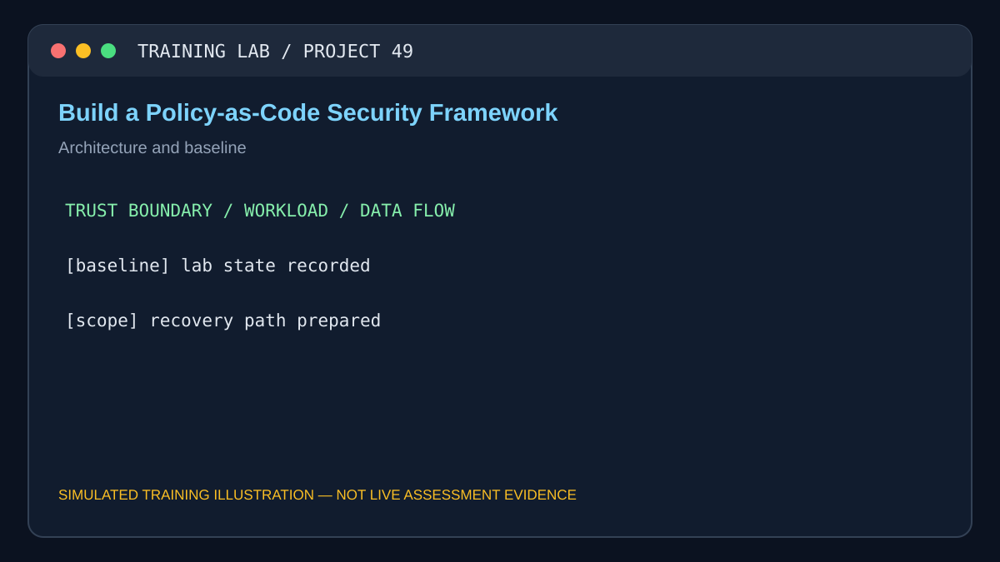
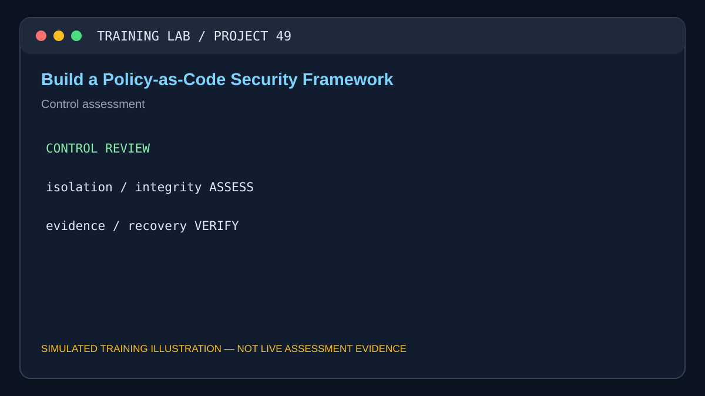
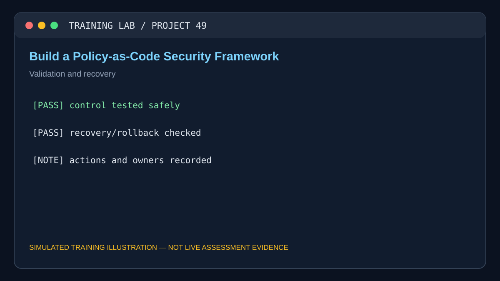

# Project 49: Build a Policy-as-Code Security Framework

**Level:** Advanced  
**Tools:** OPA Gatekeeper, Kyverno, Conftest

## 1. Objectives
Create a version-controlled policy framework with tests, exception handling, and staged enforcement.
- Design a defensible workflow with explicit trust boundaries and ownership.
- Exercise the process using a disposable workload and non-sensitive data.
- Demonstrate validation, recovery, and continuous improvement.

## 2. Scope and authorization
This project is restricted to environments you own or are authorized to administer. Use a dedicated lab cluster, namespace, registry, and test identities. For incident and resilience exercises, use tabletop injects or harmless indicators only. Do not deploy ransomware, destructive payloads, host-escape exploits, or tests against production.

## 3. Prerequisites
- Isolated Kubernetes cluster with administrative access for lab setup.
- OPA Gatekeeper, Kyverno, Conftest installed; record versions and supported integrations.
- Sample workload and synthetic data.
- Secure evidence repository and documented recovery/rollback plan.

## 4. Architecture and lab setup
1. Diagram relevant actors, trust boundaries, data flows, and control points.
2. Confirm active context, cluster version, namespace, and workload identity.
3. Record baseline policies, images, storage, and telemetry.
4. Prepare a disposable test workload and verify restore/recovery options.

## 5. Guided workflow
1. Define the security objective, assumptions, and success criteria.
2. Review the baseline architecture and identify single points of failure or trust.
3. Implement the selected isolation, evidence, resilience, policy, or architecture control.
4. Exercise the control using a benign scenario and a negative test.
5. Verify logs, enforcement, recovery, or policy outcomes.
6. Document gaps, remediation owners, and follow-up validation.

## 6. Commands
```bash
conftest test ./manifests --policy ./policy
kubectl get constraints 2>/dev/null || true
kubectl get clusterpolicy 2>/dev/null || true
```
Replace placeholders with resources from your lab. Confirm the active context before applying any changes. Avoid collecting secret values or personal data.

## 7. Expected observations
- Architecture or workflow diagram with documented assumptions.
- Evidence that the intended control is active.
- A safe positive and negative test result.
- Recovery, rollback, or exception path with accountable owners.
- Documented residual risks and measurable improvement actions.

## 8. Defensive design and remediation
Use reusable policy modules, automated unit tests, staged audit-to-enforce rollout, narrowly scoped exceptions, and policy change reviews.
- Apply defense in depth across build, registry, deployment, runtime, and response.
- Prefer immutable artifacts, short-lived identities, and least-privilege permissions.
- Protect logs, backups, policy sources, and signing keys.
- Define service ownership, alerting, retention, testing cadence, and escalation paths.

## 9. Validation criteria
- [ ] Scope, assumptions, and safety boundaries documented
- [ ] Architecture and baseline captured
- [ ] Control implemented in source configuration
- [ ] Safe test scenario executed
- [ ] Enforcement/monitoring/recovery verified
- [ ] Gaps and exceptions assigned to owners
- [ ] Retest and cleanup completed

## 10. Framework mapping
Use CIS Kubernetes Benchmark, NIST SP 800-190, NIST SP 800-61 for incident response, NIST SP 800-53 as an enterprise control reference, and SLSA/in-toto for supply-chain controls where applicable. Use MITRE ATT&CK Containers only for behaviors actually demonstrated.

## 11. Evidence and final report
Include executive summary, architecture, scope, assumptions, control inventory, sanitized configuration, test results, evidence hashes where relevant, remediation owners, due dates, validation status, and residual risk. Protect forensic data, backups, private keys, kubeconfigs, and credentials.

## 12. Training illustrations
These are synthetic training visuals and are not screenshots from a real enterprise environment or live incident.







## 13. Completion
- [ ] Architecture and threat boundaries documented
- [ ] Control implemented and safely exercised
- [ ] Positive/negative tests captured
- [ ] Recovery/rollback validated
- [ ] Final report and improvement plan delivered
